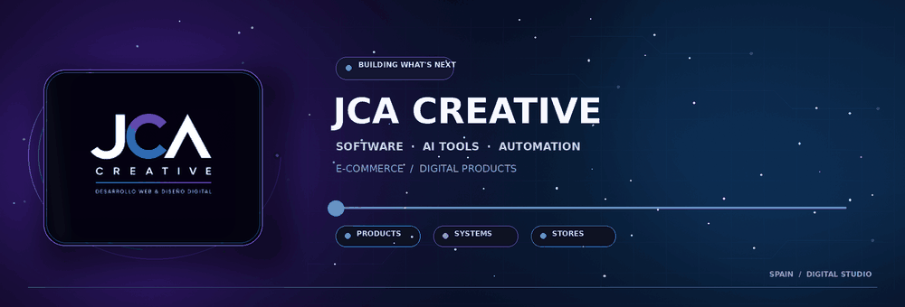

  
   
   
  
  
   
   

## We build useful technology for modern businesses.

JCA Creative is a Spain-based digital company working across **software development, AI tools, automation, and e-commerce**. We turn business needs into practical digital products and connected systems.

<table>
  <tr>
    <td width="50%" valign="top">
      <h3>⌘ Software development</h3>
      Custom applications, backend systems, and digital products built around real needs.
    </td>
    <td width="50%" valign="top">
      <h3>✦ AI tools</h3>
      Useful AI-powered products and features for business workflows and content creation.
    </td>
  </tr>
  <tr>
    <td width="50%" valign="top">
      <h3>↗ Automation</h3>
      Connected workflows that reduce repetitive work and help teams move faster.
    </td>
    <td width="50%" valign="top">
      <h3>▣ E-commerce</h3>
      Shopify development and digital solutions that support online businesses.
    </td>
  </tr>
</table>

## How we work

We focus on clear experiences, reliable engineering, and technology that solves practical problems. From the first idea to the finished product, our goal is to make digital work simpler and more useful.

   
  <b>SOFTWARE&nbsp; · &nbsp;AI&nbsp; · &nbsp;AUTOMATION&nbsp; · &nbsp;E-COMMERCE</b>
   
   
  <a href="https://jcacreative.es">jcacreative.es</a>
  &nbsp;•&nbsp;
  <a href="mailto:support@jcacreative.es">support@jcacreative.es</a>
   
  Built in Spain. Made for what's next.

